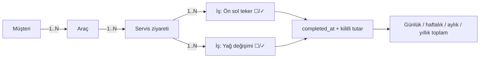

# ServisFlow — Araç Bazlı Servis İş Takibi ve Dönemsel Brüt İş Bedeli Raporlama

> **Durum:** Faz 1 ve Faz 2 tamamlandı. Faz 3 sürüyor: yedi use case'in servis katmanı ve ekranları `main`'de, uygulama uçtan uca çalışıyor.  
> **Ders:** Yazılım Kalite Standartları · **Ekip:** 7 kişi · **Son güncelleme:** 13.11.2026

**ServisFlow**, küçük bir oto serviste her araç için **To-Do uygulaması mantığında yapılacak işler listesi** tutan, işler **✓** ile tamamlandığında tutarlarını tamamlanma gününe yazan ve **günlük / haftalık / aylık / yıllık brüt iş bedelini** raporlayan sade bir web uygulamasıdır.

Proje bilinçli olarak **dar bir MVP** olarak tasarlanmıştır: amaç çok özellik eklemek değil, az sayıda özelliği **ölçülebilir kalite hedefleriyle, test edilmiş ve izlenebilir biçimde** geliştirmektir.

## 🎯 Somut işleyiş

**Örnek (temsili kayıtlar):**

1. `Müşteri ekle` → **Can GPT** kaydı oluşturulur.
2. `Araç ekle` → **34 BJK 321 — Isuzu 10 Long** bu müşteriye bağlanır.
3. Araç servise geldiğinde `Yeni servis ziyareti` açılır; **tarih/saat sistem tarafından otomatik** kaydedilir.
4. Ziyarete yapılacak işler eklenir:

   | ✓ | İş başlığı | Not | Tutar |
   | :---: | :--- | :--- | ---: |
   | ☐ | Ön sol teker | Bilya, keçe, bijon + işçilik | 1.600 TL |
   | ☐ | Yağ değişimi | Motor yağı + filtre | 1.200 TL |

5. İş bitince yanındaki **✓** işaretlenir. Sistem **tamamlanma zamanını** atar, işin tutarını kilitler ve iş **tamamlandığı günün** raporunda **yalnızca bir kez** görünür.
6. Araç başka gün tekrar gelirse **yeni bir servis ziyareti** açılır; önceki ziyaretlerin geçmişi korunur.

## 📅 Dönemsel brüt iş bedeli

Raporlar, **tüm araçlardaki ✓ yapılmış işleri** `completed_at` tarihine göre toplar. Gün sınırları `Europe/Istanbul` takvimine göredir.

| Tamamlanma günü | İş | O günün brüt iş bedeli |
| :--- | :--- | ---: |
| 22 Ekim | Ön sol teker ✓ | 1.600 TL |
| 23 Ekim | Yağ değişimi ✓ | 1.200 TL |
| **İki günü kapsayan hafta** | | **2.800 TL** |

- Açık (✓ yapılmamış) işler rapora girmez.
- ✓ iki kez tıklansa da tutar **ikiye katlanmaz** (idempotent tamamlama).
- Dün açılıp bugün ✓ yapılan iş **bugüne** yazılır.

> **Finansal tanım:** Bu metrik *tamamlanan işlerin brüt bedelidir*; tahsil edilmiş para, net kâr veya muhasebe geliri değildir.

## 📋 Yedi kullanım durumu

| UC | Kullanım durumu | Odak kalite özelliği (ISO/IEC 25010) |
| :--- | :--- | :--- |
| **UC-01** | Kimlik Doğrulama ve Güvenli Oturum Yönetimi | Güvenlik |
| **UC-02** | Müşteri Kaydı, Girdi Doğrulama ve Arama | Fonksiyonel uygunluk |
| **UC-03** | Araç Kaydı, Plaka Normalizasyonu ve Tekillik Denetimi | Veri bütünlüğü |
| **UC-04** | Servis Ziyareti (İş Emri) Açılışı ve Otomatik Zaman Damgalama | İşlemsel doğruluk |
| **UC-05** | Görev Tabanlı İş Listesi Yönetimi (ekle / düzenle / sil) | Kullanılabilirlik, doğruluk |
| **UC-06** | İdempotent Görev Tamamlama (✓) ve Tutar Kilitleme | Güvenilirlik, tutarlılık |
| **UC-07** | Araç Servis Geçmişi ve Zaman Dilimi Duyarlı Dönemsel Raporlama | Doğruluk, kullanılabilirlik |

## 👥 Ekip

| Üye | İsim | Proje rolü | Sahibi olduğu use case |
| :--- | :--- | :--- | :--- |
| 1 | Ahmet Karavuş | Kimlik Doğrulama ve Güvenlik Geliştiricisi | UC-01 |
| 2 | Alperhan Karşı | İş Analisti / Gereksinim Mühendisi | UC-02 |
| 3 | Mehmet Kenan Dilberoğlu | Scrum Master / Backend | UC-03 |
| 4 | Ilgın Çutok | UI/UX / Dokümantasyon | UC-04 |
| 5 | Kerem Erden | Yazılım Mimarı / DevSecOps | UC-05 |
| 6 | Mehmet Ünsalan | Backend / Beyaz Kutu Testleri | UC-06 |
| 7 | Ahmet Selim Dostabakan | Ekip Lideri / QA ve Test Lideri | UC-07 |

### Use case sorumluları (Faz 3 itibarıyla)

| Use case | Sahibi (yönerge: kişi başı en az 1 UC) | Geliştiren | İnceleyen (PR onayı) |
| :--- | :--- | :--- | :--- |
| UC-01 | Ahmet Karavuş | Kerem Erden (servis #15, giriş ekranı #18) | Ahmet Selim Dostabakan (#15, #18) |
| UC-02 | Alperhan Karşı | Kerem Erden (servis #15, ekran #19) | Ahmet Selim Dostabakan (#15, #19) |
| UC-03 | Mehmet Kenan Dilberoğlu | Kerem Erden (servis #15, ekran #19, plaka önerisi #20) | Ahmet Selim Dostabakan (#15, #19, #20) |
| UC-04 | Ilgın Çutok | Kerem Erden (servis #15, ekran #19) | Ahmet Selim Dostabakan (#15, #19) |
| UC-05 | Kerem Erden | Kerem Erden (servis #15, ekran #19, tam TL #20) | Ahmet Selim Dostabakan (#15, #19, #20) |
| UC-06 | Mehmet Ünsalan | Kerem Erden (servis #16, ekran #19) | Ahmet Selim Dostabakan (#16, #19) |
| UC-07 | Ahmet Selim Dostabakan | Ahmet Selim Dostabakan (servis #11, #17); Kerem Erden (rapor ekranı #19) | Kerem Erden (#11, #17); Ahmet Selim Dostabakan (#19) |

Her use case'in bir sahibi vardır ve sahiplik değişmedi. Kodu fiilen yazan ve inceleyen üyeler ayrıca gösterilir; ayrıntılı kayıt Faz 3 Raporu 3.3 ve 3.4'tedir. UC-01 – UC-04 sahipleri Faz 3 sırasında GitHub organizasyonuna eklenmediği, UC-06 sahibi de bu dönemde ulaşılamadığı için bu use case'leri Kerem Erden geliştirdi (YZ destekli).

## 🔄 Veri ilişkileri



**Tablolar:** `User`, `Customer`, `Vehicle`, `ServiceVisit`, `ServiceTask`. Tutarlar **kuruş cinsinden tamsayı** saklanır; zaman damgaları UTC tutulur, raporlar İstanbul saatine çevrilerek hesaplanır.

## 🚫 Kapsam dışı (bilinçli olarak)

Stok/envanter, parça bazlı fiyat satırları, çoklu rol ve yetki matrisi, ödeme/tahsilat, fatura/KDV, çoklu şube, SMS/WhatsApp bildirimleri, mobil uygulama.

## 🛠️ Teknoloji ve kalite araç seti

| Katman | Araç |
| :--- | :--- |
| Dil / arayüz | Python 3.11+ / Streamlit |
| Veri | SQLite / SQLAlchemy |
| Parola güvenliği | Argon2id (`argon2-cffi`) |
| Test / kapsama | pytest / pytest-cov |
| Karmaşıklık | radon (McCabe) |
| Stil / statik analiz | black / flake8 |
| Güvenlik taraması | bandit (kaynak kod), pip-audit (bağımlılıklar) |
| Karmaşıklık eşiği (CI) | xenon (radon tabanlı) |
| Süreç | GitHub Projects (Scrumban), PR + code review, GitHub Actions (CI) |

**Mimari:** Katmanlı monolit — `ui` (Streamlit ekranları) → `services` (iş kuralları, arayüzden bağımsız ve test edilebilir) → `repository` (veritabanı erişimi).

**Kalite hedefleri (ekip önerisi):** `services` katmanında ≥ %80 satır kapsama; fonksiyon başına McCabe ≤ 10; bandit'te yüksek önemli bulgu = 0; her PR'da en az 1 onay; CI yeşil olmadan `main`'e birleştirme yok.

## 📂 Planlanan dosya düzeni

```text
servisflow/
├── README.md
├── docs/
│   ├── Faz1_Raporu.md
│   ├── Faz2_Raporu.md
│   ├── Faz3_Raporu.md
│   └── Sunum_Notlari.md
├── src/servisflow/
│   ├── ui/            # Streamlit ekranları
│   ├── services/      # İş kuralları (UC mantığı)
│   └── repository/    # SQLAlchemy modelleri ve sorgular
├── tests/             # pytest birim ve entegrasyon testleri
├── pyproject.toml     # pytest, coverage ve black ayarları
├── .flake8            # flake8 ayarları
├── requirements.txt / requirements-dev.txt
└── .github/           # CI (black, flake8, bandit, pip-audit, radon/xenon, pytest-cov)
```

## 🚀 Kurulum

```bash
git clone https://github.com/servisflow/servisflow.git
cd servisflow
python -m venv .venv
source .venv/bin/activate            # Windows: .venv\Scripts\activate
pip install -r requirements.txt -r requirements-dev.txt
pip install -e .
```

İşletme sorumlusu hesabını oluşturma (bir kez; parola en az 8 karakter):

```bash
python -m servisflow.create_owner
```

Uygulamayı çalıştırma (repo kökünden):

```bash
streamlit run src/servisflow/ui/app.py
```

Tarayıcıda `http://localhost:8501` açılır: giriş → **Müşteriler ve araçlar** → **Servis ve işler** (ziyaret, iş, ✓) → **Rapor**.

> **Windows notu:** `pip install -e .` *WinError 145 (The directory is not empty)* ile durursa sorun koddan değil, geçici klasörü kilitleyen antivirüsten kaynaklanır. `python -m pip install --upgrade pip setuptools` sonrası komutu tekrarlayın; acil durumda `$env:PYTHONPATH = "src"` ile paket kurulmadan çalıştırılabilir.

### ☁️ Bulutta çalıştırma (Streamlit Community Cloud)

**Canlı sürüm:** https://servisflow.streamlit.app/ (yalnızca uydurma verilerle deneyin; veriler kalıcı değildir)

Kendi kopyanızı yayınlamak için (Faz 4 - iv):

1. share.streamlit.io'ya GitHub hesabıyla girin → **Create app** → depo `servisflow/servisflow`, dal `main`, ana dosya `streamlit_app.py`.
2. **Advanced settings** → Python 3.12; **Secrets** alanına sorumlu hesabını yazın (parola depoya girmez):

   ```toml
   [owner]
   username = "sorumlu"
   password = "en-az-8-karakterlik-parola"
   ```

3. **Deploy**. İlk açılışta hesap sırlardan oluşturulur; giriş ekranı gelir.

> **Bilinen kısıt:** Bulutta veritabanı kalıcı değildir; uygulama uyuyup yeniden başladığında veya yeniden yayınlandığında kayıtlar silinir, hesap sırlardan yeniden oluşur. Adres herkese açıktır; **gerçek müşteri bilgisi girmeyin**, yalnızca uydurma verilerle deneyin.

Kalite kapılarını yerelde çalıştırma (CI'daki adımların aynısı):

```bash
black --check src tests streamlit_app.py                 # biçim
flake8 src tests streamlit_app.py                        # stil
bandit -r src --severity-level high                      # güvenlik (kod)
pip-audit -r requirements.txt -r requirements-dev.txt    # güvenlik (bağımlılık)
xenon src --max-absolute B --max-modules B --max-average A   # McCabe ≤ 10
pytest --cov                                             # testler + satır/dal kapsama ≥ %80
```

Her push ve pull request'te bu adımlar [GitHub Actions](.github/workflows/ci.yml) tarafından otomatik çalıştırılır.

📄 Faz 1 raporu: [`docs/Faz1_Raporu.md`](docs/Faz1_Raporu.md) · Faz 2 raporu: [`docs/Faz2_Raporu.md`](docs/Faz2_Raporu.md) · Faz 3 raporu (taslak): [`docs/Faz3_Raporu.md`](docs/Faz3_Raporu.md)

## 🗓️ Ders fazları

| Faz | Teslim | Beklenen çıktı |
| :--- | :--- | :--- |
| **1** | Hafta 4 | Ekip, kapsam, teknoloji, ortamlar, süreç, 7 use case, gereksinimler |
| **2** | Hafta 7 | Faz 1 review, test planı, kalite kapıları, risk değerlendirmesi |
| **3** | Hafta 9 | Mimari ve teknik kararlar, kodlama, code review |
| **4** | Hafta 12 | Kara/beyaz kutu, kullanıcı testleri, McCabe, deployment |
| **5** | Hafta 14 | En fazla 20 sayfalık final raporu, DIR, kaynakça ve demo |

## 🤖 DIR ve kaynaklar

- v0.3 (22.10.2026): README ve Faz 1 raporu **ChatGPT** yardımıyla taslak olarak hazırlandı.
- v0.4 (24.10.2026): Ekip kararıyla kapsam daraltıldı (stok, parça satırları, çoklu rol ve audit log çıkarıldı); belgeler **Claude (Anthropic)** yardımıyla yeniden düzenlendi.

İnsan değerlendirmesi ve DIR skorlaması ekipçe yapılacaktır; gerçekleşmemiş testler veya incelemeler yapılmış gibi gösterilmez.

> Demo ve testlerde sentetik müşteri ve plaka verileri kullanılır; gerçek müşteri verileri sisteme girilmez.
