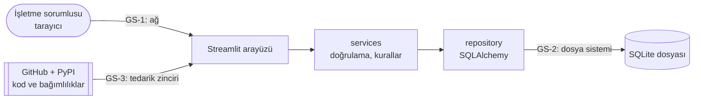

# PROJE RAPORU: FAZ 2 ÇIKTILARI — Stratejik Kalite ve Kontrat Planlaması

- **Proje Adı:** ServisFlow — Araç Bazlı Servis İş Takibi ve Dönemsel Brüt İş Bedeli Raporlama
- **Ders:** Yazılım Kalite Standartları (YAZ401)
- **Doküman Durumu:** v1.0 — ekip tarafından incelendi ve onaylandı (11.11.2026)
- **Hazırlanma Tarihi:** 11.11.2026 · **Teslim:** Hafta 7 (izlence)
- **Koordinasyon:** Üye 7 (Ahmet Selim Dostabakan, QA/Test Lideri) · Üye 5 (Kerem Erden, DevSecOps)

| Yönerge maddesi | Bu belgedeki karşılığı |
| :--- | :--- |
| i. Gereksinimler başta olmak üzere Faz 1 çıktılarının gözden geçirilmesi ve iyileştirilmesi | Bölüm 1 |
| ii. Kalite kapılarının tanımlanması ve test planının oluşturulması | Bölüm 2 ve 3 |
| iii. Tasarımdan itibaren güvenlik zayıflıklarının önlenmesi amacıyla risk değerlendirmesi | Bölüm 4 |

---

## 1. Faz 1 Çıktılarının Gözden Geçirilmesi ve İyileştirilmesi (Faz 2 - i)

### 1.1. İnceleme Yöntemi

- **İncelenen çıktılar:** Faz 1 Raporu v1.2 — iş kuralları (BR), fonksiyonel ve fonksiyonel olmayan gereksinimler (FR/NFR), use case'ler, veri modeli, izlenebilirlik matrisi ve test senaryoları.
- **İnceleme türü:** Ekip içi teknik inceleme (walkthrough). İnceleme lideri QA lideri (Üye 7); her use case sahibi kendi bölümüne gelen bulguyu kabul veya ret eder.
- **Ölçüt:** ISO/IEC/IEEE 29148'in iyi gereksinim özellikleri. Her gereksinim **tek anlamlı**, **doğrulanabilir** (test edilebilir), **tutarlı** (başka kuralla çelişmeyen), **eksiksiz** ve **izlenebilir** olmalıdır.
- **Önem dereceleri:** **Yüksek** = yanlış rapor, veri kaybı veya güvenlik açığına yol açar · **Orta** = farklı yorumlanıp farklı kodlanabilir · **Düşük** = belgeleme tutarsızlığı.

### 1.2. İnceleme Bulguları

| No | Yer | Bulgu | İhlal edilen özellik | Önem | Karar |
| :--- | :--- | :--- | :--- | :---: | :--- |
| **RV-01** | BR-02, BR-04 | ✓ ile kilitlenen tutar, “✓ geri al → düzenle → tekrar ✓” yoluyla **sonradan değiştirilebiliyor**. Geçmiş bir günün raporu sessizce değişebilir ve iş bambaşka bir güne taşınabilir. Audit log kapsam dışı olduğundan bu değişiklik izlenemez. | Tutarlı | Yüksek | BR-04 daraltıldı: geri alma **yalnızca işin tamamlandığı İstanbul takvim günü içinde** yapılabilir. Gün geçtikten sonra `DONE` kesindir. |
| **RV-02** | BR-07, UC-03 | Plaka “Türkçe karakter kurallarıyla” büyük harfe çevriliyor. Ancak Türk plakalarında Ç, Ğ, İ, Ö, Ş, Ü kullanılmaz: `34 abi 12` girişi Türkçe kurallarla `34ABİ12` olur ve geçerli bir plaka değildir. | Tutarlı | Orta | Normalizasyon **Latin büyük harf** (`i → I`) ile yapılır. Türkçe karakter içeren plaka reddedilir. |
| **RV-03** | UC-03 | “Geçersiz plaka formatı” tanımlı değil. | Tek anlamlı, doğrulanabilir | Orta | Format tanımlandı: il kodu 01–81 + 1–3 harf + 2–4 rakam (BR-07). |
| **RV-04** | UC-02 | “Geçersiz telefon formatı” tanımlı değil. | Tek anlamlı, doğrulanabilir | Orta | Telefon isteğe bağlı. Girilirse boşluk, tire ve parantez temizlenir, baştaki `0` atılır ve sonuç `5` ile başlayan 10 haneli sayı olmalıdır (BR-09). |
| **RV-05** | BR-01, UC-05 | Tutarın hangi biçimde girileceği belirsiz: `1.600,50` mi, `1600.50` mi? İkiden fazla ondalık (`10,005`) ne olacak? | Tek anlamlı | Orta | Tutar sayısal alanla (TL, en fazla 2 ondalık) alınır; serbest metin ayrıştırılmaz. İkiden fazla ondalık reddedilir (BR-01). |
| **RV-06** | BR-08 | “`DONE` iş içeren ziyaret ve araç silinemez” deniyor, ancak hiçbir FR'de silme işlevi tanımlı değil. Silme kapsamda mı belirsiz. | Eksiksiz, tutarlı | Orta | MVP'de müşteri, araç ve ziyaret **silme yoktur**. Yalnızca `TODO` iş silinebilir (BR-08). |
| **RV-07** | FR-01, UC-01 | Kullanıcı hesaplarının nasıl oluşturulacağı ve tekrarlanan hatalı girişlere karşı ne yapılacağı tanımlı değil. | Eksiksiz | Yüksek | İlk kullanıcı kurulum betiğiyle oluşturulur, arayüzden kayıt yoktur. **3 ardışık hatalı girişten sonra** giriş formuna robot doğrulama (CAPTCHA) eklenir; doğrulama geçilmeden parola denenmez. Her hatalı giriş tarih ve saatiyle kaydedilir; **başarılı girişten sonra** kullanıcıya son başarılı girişinden bu yana yapılan hatalı denemelerin listesi gösterilir. CAPTCHA uygulamanın kendi sunucusunda üretilir (dış servis kullanılmaz, veri üçüncü tarafa gitmez). (FR-01) *İlk öneri olan “5 hatalı girişte 5 dk kilit” ekip incelemesinde bu kararla değiştirildi.* |
| **RV-08** | Aktörler, UC'ler | Aktör “Servis Personeli” olarak tanımlı; sisteme kimin giriş yaptığı (her usta mı, işletme sahibi mi) belirsiz. Bu belirsizlik hesap sayısını, yetkiyi ve “işi kim tamamladı” bilgisini doğrudan etkiliyor. | Tek anlamlı | Yüksek | Ekip kararı: sistemin **tek kullanıcısı işletme sorumlusudur**. Ustalar sisteme giriş yapmaz, yaptıkları işi sorumluya bildirir ve kaydı sorumlu girer. Usta başına hesap ve “kim tamamladı” alanı gerekmez. |
| **RV-09** | NFR-04 | “Çift istek tek tamamlama üretir” hedefi var ama nasıl sağlanacağı yok. | Doğrulanabilir | Orta | Tasarım kararı: tamamlama tek bir koşullu güncelleme ile yapılır (`... WHERE id = ? AND status = 'TODO'`). Etkilenen satır 0 ise işlem değişiklik yapmadan başarılı sayılır. |
| **RV-10** | UC-04, UC-06, test | `opened_at` ve `completed_at` sistem saatinden alınıyor; gece yarısı sınırı testleri (TC-12) gerçek saate bağlı kalırsa tekrarlanamaz. | Doğrulanabilir | Orta | Tasarım kararı: servis fonksiyonları zamanı dışarıdan verilen bir **saat sağlayıcısından** (`clock`) alır. Testlerde saat sabitlenir. |
| **RV-11** | İzlenebilirlik matrisi | FR-07 (araç geçmişi) ve UC-01'in “oturumsuz erişim” davranışı hiçbir test senaryosuna bağlı değil. | İzlenebilir | Orta | Yeni test senaryoları eklendi (Bölüm 3.7: TC-03, TC-27, TC-28). |
| **RV-12** | UC-07 | “Geçersiz tarih seçimi” tanımlı değil. Tarih seçici kullanıldığında biçim hatası oluşamaz; gelecekteki bir dönemin ne döndüreceği belirsiz. | Tek anlamlı | Düşük | Tarih takvim bileşeniyle seçilir. Gelecekteki dönem seçilebilir ve `0,00 TL` döner. |
| **RV-13** | NFR-02, CI | NFR-02 kapsamayı “`services` katmanı” için tanımlıyor; CI ise `ui` hariç tüm paketi ölçüyor. | Tutarlı | Düşük | NFR-02 CI ile hizalandı: “`ui` hariç tüm kod (`services` + `repository`)”. |
| **RV-14** | Sunum, UC-01 | Streamlit varsayılan olarak hata ayrıntılarını (yığın izi) tarayıcıda gösterir; bu, iç yapı bilgisini sızdırır. Gereksinimlerde ele alınmamış. | Eksiksiz | Orta | Yeni NFR-08: kullanıcıya yalnızca genel hata mesajı gösterilir (`client.showErrorDetails = false`). |

**İnceleme sonucu (11.11.2026):** Bulgular ekip toplantısında tek tek ele alındı; her use case sahibi kendi bölümüne ait bulguları ayrıntılı inceleyip onayladı. **14 bulgunun 14'ü kabul edildi.** RV-07'nin kararı ekip tarafından değiştirildi: önerilen “5 hatalı girişte 5 dk kilit” yerine “3 hatalı girişten sonra CAPTCHA ve hatalı giriş kaydının kullanıcıya gösterilmesi” seçildi. Bu sayede saldırı denemesi hem yavaşlatılıyor hem de hesap sahibine görünür hale geliyor.

### 1.3. Güncellenen Gereksinimler

Kabul edilen bulgular Faz 1 Raporu'na **v1.3** olarak işlenmiştir. Değişen ve eklenen maddeler:

| Kod | Yeni metin |
| :--- | :--- |
| **BR-01** | Tutar sayısal alanla TL cinsinden, en fazla 2 ondalık basamakla girilir; 0,01 TL ile 1.000.000,00 TL arasında olmalıdır. Kuruş cinsinden tamsayı saklanır. |
| **BR-04** | ✓ yalnızca işin tamamlandığı **İstanbul takvim günü içinde** geri alınabilir. Geri alındığında iş `TODO`'ya döner, `completed_at` temizlenir. Gün geçtikten sonra `DONE` kesindir. |
| **BR-07** | Plaka boşluklar kaldırılıp **Latin büyük harfe** çevrilerek normalize edilir. Biçim: il kodu `01`–`81`, ardından 1–3 harf (Ç, Ğ, İ, Ö, Ş, Ü hariç), ardından 2–4 rakam. Normalize plaka sistemde tekildir. |
| **BR-08** | MVP'de müşteri, araç ve ziyaret kayıtları silinmez. Yalnızca `TODO` durumundaki iş silinebilir. |
| **BR-09** *(yeni)* | Telefon isteğe bağlıdır. Girilirse boşluk, tire ve parantez temizlenir, baştaki `0` atılır; sonuç `5` ile başlayan 10 haneli sayı olmalıdır. |
| **FR-01** | (eklenen) Sistemde yalnızca işletme sorumlusu hesabı vardır; hesap kurulum betiğiyle oluşturulur. **3 ardışık hatalı girişten sonra** giriş formuna robot doğrulama (CAPTCHA) eklenir; doğrulama geçilmeden parola denenmez. Her hatalı giriş tarih ve saatiyle kaydedilir; **başarılı girişten sonra** kullanıcıya son başarılı girişinden bu yana yapılan hatalı denemelerin listesi gösterilir. CAPTCHA uygulamanın kendi sunucusunda üretilir (dış servis kullanılmaz, veri üçüncü tarafa gitmez). |
| **NFR-02** | `ui` hariç tüm kodda (`services` + `repository`) ≥ %80 satır kapsama. |
| **NFR-08** *(yeni)* | Hata durumunda kullanıcıya yalnızca genel mesaj gösterilir; yığın izi ve iç yapı bilgisi arayüze yansımaz. |
| **Aktörler** | “Servis Personeli” yerine **İşletme Sorumlusu** (tek kullanıcı). Usta sistem dışı bir paydaştır. `User` tablosuna `failed_attempts` ve `last_login_at` alanları; hatalı denemeler için `LoginAttempt` (`id`, `attempted_at`, `success`) tablosu eklendi. |

---

## 2. Kalite Kapıları (Faz 2 - ii)

Kalite kapısı, bir çıktının bir sonraki aşamaya geçmesi için sağlaması gereken **ölçülebilir** koşullar kümesidir. Kapıların çoğu GitHub Actions ile otomatik denetlenir; otomatikleştirilemeyen koşullar PR şablonu ve faz kontrol listesiyle insan tarafından denetlenir.

### 2.1. Kapı Tanımları

| Kapı | Ne zaman | Geçiş koşulları | Denetim | Kapıyı kim açar |
| :--- | :--- | :--- | :--- | :--- |
| **KK-1 Gereksinim kapısı** | Bir faz kapanmadan önce | Tüm “Yüksek” inceleme bulguları kapatılmış · her FR en az bir UC'ye ve bir test senaryosuna bağlı · açık sorular listesi boş | Faz kontrol listesi, izlenebilirlik matrisi | QA lideri + ilgili UC sahibi |
| **KK-2 Birleştirme (PR) kapısı** | Her PR, `main`'e birleştirmeden önce | CI'daki 7 otomatik kontrolün tamamı geçer (Bölüm 2.2) · en az 1 ekip üyesinin onayı · PR şablonundaki kontrol listesi işaretli · ilgili issue bağlı | GitHub Actions + dal koruma kuralı + PR şablonu | PR'ı açan dışındaki bir üye |
| **KK-3 Test tamamlama kapısı** | Faz 4 sonu | Planlanan tüm test senaryoları çalıştırılmış · Kritik/Yüksek açık hata = 0 · UAT başarı oranı ≥ %90 · McCabe raporu yorumlanmış | Test sonuç tablosu, GitHub Issues, radon raporu | QA lideri |
| **KK-4 Devreye alma kapısı** | Faz 4, yayından önce | KK-3 geçilmiş · `main` CI yeşil · kurulum adımları temiz bir makinede README'ye göre denenmiş · gizli bilgi (parola, anahtar) depoda yok | Kurulum denemesi, GitHub secret scanning | Mimar (Üye 5) + QA lideri |

### 2.2. KK-2'nin Otomatik Kontrolleri (CI)

| Sıra | Kontrol | Araç | Eşik | Bağlı gereksinim |
| :---: | :--- | :--- | :--- | :--- |
| 1 | Biçim | black | Fark = 0 | Bakım yapılabilirlik |
| 2 | Stil ve statik hata | flake8 | Uyarı = 0 | Bakım yapılabilirlik |
| 3 | Güvenlik (kaynak kod) | bandit | Yüksek önemli bulgu = 0 | NFR-03 |
| 4 | Güvenlik (bağımlılık) | pip-audit | Bilinen açığı olan bağımlılık = 0 | Bölüm 4, R-12 |
| 5 | Karmaşıklık | radon + xenon | Fonksiyon başına McCabe ≤ 10 (B sınıfı) | NFR-01 |
| 6 | Testler | pytest | Başarısız test = 0 | Tüm FR |
| 7 | Kapsama | pytest-cov | `ui` hariç ≥ %80 | NFR-02 |

Kontrollerden biri başarısız olursa PR birleştirilemez. Eşiğin geçici olarak düşürülmesi yalnızca ekip kararıyla ve gerekçesi PR'a yazılarak yapılabilir.

### 2.3. Kod İnceleme Kontrol Listesi (PR şablonu)

İnceleyen üye PR'ı onaylamadan önce şu soruları yanıtlar:

- [ ] PR bir issue'ya bağlı ve hangi FR/UC'yi karşıladığı yazılı mı?
- [ ] Yeni iş kuralı için birim testi var mı? Sınır değerler test edilmiş mi?
- [ ] Zaman `clock` sağlayıcısından mı alınıyor (doğrudan `datetime.now()` yok)?
- [ ] Para tamsayı kuruş olarak mı işleniyor (float yok)?
- [ ] Veritabanı erişimi ORM ile mi (string birleştirmeyle SQL yok)?
- [ ] Kullanıcı girdisi `services` katmanında doğrulanıyor mu?
- [ ] Hata mesajları iç bilgi sızdırmıyor mu?
- [ ] YZ ile üretilen kod varsa PR açıklamasında belirtilmiş ve DIR kaydına eklenmiş mi?

### 2.4. Dal Koruma Kuralı

`main` dalı için GitHub'da şu kural açılacaktır: doğrudan push yasak · birleştirme yalnızca PR ile · CI başarılı olmalı · en az 1 onay · onaydan sonra yeni commit gelirse onay geçersiz.

---

## 3. Test Planı (Faz 2 - ii)

Plan, ISO/IEC/IEEE 29119-3'teki test planı başlıkları esas alınarak sadeleştirilmiştir.

### 3.1. Kapsam

| Test edilecek | Test edilmeyecek (gerekçe) |
| :--- | :--- |
| BR-01 – BR-09 iş kuralları | Streamlit'in kendi bileşenleri (üçüncü taraf kütüphane) |
| FR-01 – FR-08 ve UC-01 – UC-07 akışları | Tarayıcı uyumluluğu (tek modern tarayıcı hedeflenir) |
| NFR-01 – NFR-08 ölçümleri | Yük ve performans testi (tek şube, birkaç eşzamanlı kullanıcı) |
| Güvenlik önlemleri (Bölüm 4) | Sızma testi (ders kapsamı dışında; statik tarama ve güvenlik test senaryolarıyla sınırlı) |

### 3.2. Test Seviyeleri

| Seviye | Neyi sınar | Nasıl | Ne zaman |
| :--- | :--- | :--- | :--- |
| **Birim** | `services` fonksiyonları: doğrulama, normalizasyon, tutar dönüşümü, durum geçişleri, dönem hesabı | pytest; veritabanı ve saat sahte nesnelerle | Faz 3, kodla birlikte (her PR) |
| **Entegrasyon** | `services` + `repository` birlikte: tekillik kısıtı, koşullu ✓ güncellemesi, rapor sorgusu | pytest; bellekte SQLite (`sqlite:///:memory:`) | Faz 3–4 |
| **Sistem** | Uçtan uca akış: giriş → müşteri → araç → ziyaret → iş → ✓ → rapor | Streamlit `AppTest` ile otomatik + elle senaryo yürütme | Faz 4 |
| **Kabul (UAT)** | İşletme sahibi profiline yakın bir kişinin, ustadan gelen bir iş bildirimini sisteme yardımsız kaydetmesi (NFR-06) | Gözlemli oturum, süre ölçümü, anket | Faz 4 |

### 3.3. Test Teknikleri

| Teknik | Uygulandığı yer |
| :--- | :--- |
| **Denklik sınıfları** | Plaka (geçerli / Türkçe harfli / yanlış il kodu / fazla harf), telefon, arama |
| **Sınır değer analizi** | Tutar (0,00 / 0,01 / 1.000.000,00 / 1.000.000,01), ad uzunluğu (0 / 1 / 100 / 101), gün sınırı (23:59:59 / 00:00:00) |
| **Durum geçiş testi** | `TODO` ↔ `DONE` geçişleri, aynı gün ve ertesi gün geri alma |
| **Karar tablosu** | ✓ geri alma kuralı (Bölüm 3.4) |
| **Hata tahmini** | Çift tıklama, boş form gönderimi, aynı anda iki sekmeden ✓ |
| **Beyaz kutu (dal kapsama)** | `services` fonksiyonlarının tüm `if` dalları; `pytest --cov --cov-branch` ile ölçülür |

### 3.4. Örnek Karar Tablosu — ✓ Geri Alma (BR-04)

| Koşul / Kural | K1 | K2 | K3 | K4 |
| :--- | :---: | :---: | :---: | :---: |
| İş `DONE` mı? | E | E | H | H |
| Tamamlandığı İstanbul günü bugün mü? | E | H | – | – |
| **Sonuç** | `TODO`'ya döner, `completed_at` temizlenir | Reddedilir, “Geçmiş günün işi geri alınamaz” | Değişiklik yok | Değişiklik yok |
| Test | TC-19 | TC-20 | TC-21 | TC-21 |

### 3.5. Test Ortamı ve Verisi

- **Ortam:** Python 3.11, `requirements.txt` + `requirements-dev.txt` (sabit sürümler); CI'da Ubuntu, yerelde Windows/macOS.
- **Veritabanı:** Testlerde bellekte SQLite; her test temiz bir veritabanıyla başlar.
- **Zaman:** Testlerde `clock` sabitlenir (ör. `2026-10-22 23:59:59 Europe/Istanbul`).
- **Veri:** Yalnızca sentetik müşteri, plaka ve telefon. Gerçek kişisel veri kullanılmaz (NFR-07).

### 3.6. Giriş, Çıkış ve Askıya Alma Kriterleri

| Kriter | Tanım |
| :--- | :--- |
| **Giriş** | İlgili UC'nin gereksinimleri KK-1'den geçmiş; kod derleniyor ve CI çalışıyor. |
| **Çıkış (seviye başına)** | Birim/entegrasyon: tüm testler geçer ve kapsama ≥ %80. Sistem: tüm TC'ler çalıştırılmış ve Kritik/Yüksek açık hata yok. UAT: ≥ %90 görev başarısı. |
| **Askıya alma** | CI ortamı çalışmıyorsa veya bir Kritik hata akışı tamamen engelliyorsa testler durdurulur; hata düzeltilince kaldığı yerden devam edilir. |

### 3.7. Test Senaryoları

Faz 1'deki 13 senaryo genişletilmiş ve yeniden numaralandırılmıştır. Faz 1 numarası parantez içinde verilmiştir.

| TC | UC / Kural | Teknik | Girdi / koşul | Beklenen | Seviye |
| :--- | :--- | :--- | :--- | :--- | :--- |
| TC-01 (01) | UC-01 | Denklik | Doğru kullanıcı, yanlış parola | Reddedilir, genel hata mesajı | Birim |
| TC-02 (02) | UC-01 | Beyaz kutu | Kayıtlı kullanıcının veritabanı satırı | `password_hash` `$argon2id$` ile başlar, düz metin yok | Entegrasyon |
| TC-03 | UC-01 | Kara kutu | Oturum açmadan rapor sayfası | Giriş ekranına yönlendirilir | Sistem |
| TC-04 | UC-01, FR-01 | Sınır değer | 2 / 3 ardışık hatalı giriş; ardından CAPTCHA yanlış + parola doğru | 2'den sonra CAPTCHA yok; 3'ten sonra CAPTCHA istenir; CAPTCHA yanlışsa doğru parola da kabul edilmez | Birim |
| TC-05 | UC-01 | Denklik | Var olmayan kullanıcı adı | TC-01 ile **aynı** mesaj | Birim |
| TC-06 (03) | UC-02 | Denklik | “Can GPT” kaydı, “can” araması | Kayıt bulunur | Entegrasyon |
| TC-07 | UC-02 | Sınır değer | Ad uzunluğu 0 / 1 / 100 / 101 | Red / kabul / kabul / red | Birim |
| TC-08 | UC-02, BR-09 | Denklik | `0532 123 45 67` / `(532) 123-4567` / `212 123 4567` / `53212` | Kabul (`5321234567`) / kabul / red / red | Birim |
| TC-09 | UC-02 | Denklik | “ŞÜKRÜ” kaydı, “şükrü” araması | Kayıt bulunur | Entegrasyon |
| TC-10 (04) | UC-03, BR-07 | Denklik | `34BJK321` varken `34 bjk 321` | Reddedilir (tekil) | Entegrasyon |
| TC-11 | UC-03, BR-07 | Denklik | `34 abi 12` | `34ABI12` olarak kabul | Birim |
| TC-12 | UC-03, BR-07 | Denklik | `34 ŞK 123` / `82 AB 123` / `34 ABCD 12` | Üçü de reddedilir | Birim |
| TC-13 (05) | UC-04 | Beyaz kutu | Sabit saatle ziyaret açılır | `opened_at` = sabit saat | Birim |
| TC-14 | UC-04 | Kara kutu | Aynı araca iki farklı günde ziyaret | İki ayrı ziyaret listelenir | Entegrasyon |
| TC-15 (06) | UC-05, BR-01 | Sınır değer | 0,00 / 0,01 / 1.000.000,00 / 1.000.000,01 TL | Red / kabul / kabul / red | Birim |
| TC-16 | UC-05, BR-01 | Denklik | 1.600,50 TL / 10,005 TL | `160050` kuruş / red | Birim |
| TC-17 (07) | UC-05, BR-02 | Durum geçişi | `DONE` işi düzenleme ve silme | İkisi de reddedilir | Birim |
| TC-18 (08) | UC-06, BR-03 | Durum geçişi | Aynı işe iki kez ✓ | Tek tamamlama, `completed_at` değişmez | Entegrasyon |
| TC-19 (09) | UC-06, BR-04 | Karar tablosu K1 | Aynı gün ✓ → geri al → ✓ | Yeni `completed_at`, toplamda bir kez | Birim |
| TC-20 | UC-06, BR-04 | Karar tablosu K2 | Dün ✓ yapılmış işi bugün geri alma | Reddedilir | Birim |
| TC-21 | UC-06 | Karar tablosu K3–K4 | `TODO` işe geri al isteği | Değişiklik yok | Birim |
| TC-22 | UC-01 | Kara kutu | Çıkış yaptıktan sonra tarayıcının geri tuşuyla önceki sayfaya dönme | Sayfa açılmaz, giriş ekranı gelir | Sistem |
| TC-23 | UC-06, NFR-04 | Hata tahmini | İki sekmeden aynı anda ✓ | Bir tamamlama; diğer istek değişiklik yapmaz | Entegrasyon |
| TC-24 (10) | UC-07, BR-05 | Kara kutu | İş 22 Ekim'de açılır, 23 Ekim'de ✓ | Yalnız 23 Ekim toplamında | Entegrasyon |
| TC-25 (11) | UC-07 | Kara kutu | 22 Ekim 1.600 TL, 23 Ekim 1.200 TL | Günlük 1.600 / 1.200; hafta 2.800 TL | Entegrasyon |
| TC-26 (12) | UC-07, BR-06 | Sınır değer | ✓ 23:59:59 ve 00:00:00 İstanbul saati | Doğru takvim gününe düşer | Birim |
| TC-27 (13) | UC-07 | Kara kutu | Açık iş + boş dönem + gelecek dönem | Açık iş sayılmaz; boş ve gelecek dönem 0,00 TL | Entegrasyon |
| TC-28 | UC-07, FR-07 | Kara kutu | Üç ziyareti olan araç | Ziyaretler yeniden eskiye, işleriyle birlikte listelenir | Sistem |
| TC-29 | UC-07, BR-06 | Sınır değer | 31 Aralık 23:59:59 ve 29 Şubat 2028 | Doğru yıl ve ay | Birim |
| TC-30 | NFR-08 | Hata tahmini | Veritabanı bağlantısı kesilmişken işlem | Genel hata mesajı; yığın izi görünmez | Sistem |
| TC-32 | UC-01, FR-01 | Kara kutu | 3 hatalı deneme, ardından başarılı giriş; sonra tekrar çıkış ve başarılı giriş | İlk girişte 3 hatalı denemenin tarih-saati listelenir; ikinci girişte liste boştur | Entegrasyon |
| TC-31 | NFR-06 | UAT | İşletme sahibi profilindeki kişi, ustanın bildirdiği bir işi baştan sona kaydeder | ≤ 3 dakika, yardımsız | UAT |

### 3.8. Hata Yönetimi

- Her hata bir **GitHub Issue** olarak açılır (`bug` etiketi) ve proje panosunda izlenir.
- **Önem dereceleri:** **Kritik** = veri kaybı, yanlış rapor toplamı veya güvenlik açığı · **Yüksek** = bir UC tamamlanamıyor · **Orta** = geçici çözümü olan hata · **Düşük** = görsel veya metin hatası.
- Issue şunları içerir: adımlar, beklenen, gerçekleşen, ilgili TC, ekran görüntüsü.
- Düzeltme PR'ı hatayı yeniden üreten bir test içermek zorundadır (regresyon testi).

### 3.9. Sorumluluklar

| Kim | Sorumluluk |
| :--- | :--- |
| Her UC sahibi | Kendi UC'sinin birim testleri; kendi TC'lerinin Faz 4'te çalıştırılması |
| Üye 7 — QA lideri | Test planı, sistem testleri, UAT yönetimi, test sonuç raporu, KK-1 ve KK-3 |
| Üye 6 — Beyaz kutu | Entegrasyon testleri, kapsama ve McCabe ölçümleri ve yorumu |
| Üye 5 — DevSecOps | Güvenlik test senaryoları (TC-01 – TC-05, TC-22, TC-23, TC-30, TC-32), CI ve KK-4 |
| Üye 4 — UI/UX | UAT senaryosunun yürütülmesi ve kullanılabilirlik gözlemi |

### 3.10. Takvim ve Ölçülecek Metrikler

| Dönem | Test etkinliği |
| :--- | :--- |
| Hafta 7–9 (Faz 3) | Birim ve entegrasyon testleri kodla aynı PR'da yazılır |
| Hafta 10–11 (Faz 4) | Sistem testleri, hata düzeltme döngüsü |
| Hafta 12 (Faz 4) | UAT, McCabe raporu, test sonuç raporu, KK-3 ve KK-4 |

**Raporlanacak metrikler:** test geçme oranı · satır ve dal kapsaması · modül bazında ortalama ve en yüksek McCabe · önem derecesine göre bulunan ve kapanan hata sayısı · UAT görev süresi ve başarı oranı.

---

## 4. Güvenlik Risk Değerlendirmesi (Faz 2 - iii)

### 4.1. Yöntem

1. Sistemin veri akış diyagramı çizildi ve **güven sınırları** belirlendi.
2. Korunacak **varlıklar** listelendi.
3. Her bileşen **STRIDE** kategorileriyle (Spoofing, Tampering, Repudiation, Information disclosure, Denial of service, Elevation of privilege) tarandı.
4. Her tehdide **olasılık** (1–3) ve **etki** (1–3) puanı verildi: **Risk = O × E** (1–2 Düşük, 3–4 Orta, 6–9 Yüksek).
5. Tehdit, **OWASP Top 10 (2021)** kategorisiyle eşlendi ve her biri için **tasarım aşamasında alınacak önlem** ile bu önlemi doğrulayacak test veya araç belirlendi.

### 4.2. Veri Akış Diyagramı ve Güven Sınırları

- **GS-1 (tarayıcı ↔ sunucu):** Kullanıcı girdisi güvenilmezdir; tüm doğrulama sunucu tarafında, `services` katmanında yapılır.
- **GS-2 (uygulama ↔ veritabanı dosyası):** Dosyaya doğrudan erişen bir yöneticiye karşı koruma **iddia edilmez**; dosya depoya girmez ve sunucuda yalnızca uygulama kullanıcısı okuyabilir.
- **GS-3 (tedarik zinciri):** Dışarıdan gelen kod ve paketler.

### 4.3. Korunan Varlıklar

| Varlık | Neden önemli |
| :--- | :--- |
| Kullanıcı parolaları | Sızarsa sisteme yetkisiz giriş yapılır |
| Müşteri adı ve telefonu | Kişisel veri (KVKK kapsamında) |
| Tamamlanmış işler ve dönem toplamları | İşletmenin iş hacmi kararları bu sayılara dayanır; bütünlüğü kritik |
| Kaynak kod, CI ve bağımlılıklar | Ele geçirilirse tüm sistem etkilenir |

### 4.4. Tehdit ve Risk Tablosu

| ID | STRIDE | Tehdit | O | E | Risk | OWASP 2021 | Tasarım önlemi | Doğrulama |
| :--- | :---: | :--- | :---: | :---: | :---: | :--- | :--- | :--- |
| **R-01** | S | Parola tahmini / kaba kuvvet ile başkasının hesabına giriş | 2 | 3 | **6 Yüksek** | A07 | Argon2id; 3 hatalı denemeden sonra CAPTCHA; hatalı denemeler kaydedilip başarılı girişte kullanıcıya gösterilir (FR-01) | TC-04, TC-32 |
| **R-02** | I | Hata mesajından kullanıcı adının var olup olmadığının öğrenilmesi | 2 | 1 | 2 Düşük | A07 | Var olmayan kullanıcı ve yanlış parola için aynı mesaj | TC-05 |
| **R-03** | S/E | Oturum açmadan bir sayfaya doğrudan erişim | 1 | 3 | 3 Orta | A01 | Her sayfanın başında oturum denetimi (ortak `require_login` fonksiyonu) | TC-03 |
| **R-04** | T | Arama kutusu üzerinden SQL enjeksiyonu | 2 | 3 | **6 Yüksek** | A03 | Yalnızca ORM / parametreli sorgu; string birleştirmeyle SQL yasak | bandit (B608), kod inceleme listesi, enjeksiyon girdili test |
| **R-05** | T | ✓ geri alınarak geçmiş günün tutarının sessizce değiştirilmesi | 1 | 3 | 3 Orta | A04 | Geri alma yalnızca aynı gün (BR-04) | TC-20 |
| **R-06** | R | Tek hesabın parolasının ustalarla paylaşılması; bir işlemi kimin yaptığının ayırt edilememesi | 1 | 1 | 1 Düşük | A07 | Tek hesap politikası: parola yalnızca işletme sorumlusundadır ve paylaşılmaz (kullanım kılavuzunda yazılı); tam audit log kapsam dışı, kalan risk kabul edildi | UAT sırasında kılavuz kontrolü |
| **R-07** | T | Aynı anda iki ✓ isteğiyle çift sayım | 2 | 3 | **6 Yüksek** | A04 | Koşullu güncelleme (RV-09); toplamın sorgudan hesaplanması | TC-18, TC-23 |
| **R-08** | I | Hata ekranında yığın izi ve dosya yollarının görünmesi | 3 | 2 | **6 Yüksek** | A05 | `client.showErrorDetails = false` (NFR-08) | TC-30 |
| **R-09** | I | Müşteri verisinin depoya veya ekran görüntülerine sızması | 1 | 2 | 2 Düşük | A02 | Yalnızca sentetik veri; `*.db` `.gitignore`'da; teslim belgeleri depo dışında | Veri seti incelemesi |
| **R-10** | I | Parola veya gizli anahtarın depoya commit edilmesi | 1 | 3 | 3 Orta | A05 | Depoda gizli bilgi tutulmaz; `.env` `.gitignore`'da; GitHub secret scanning ve push protection | KK-4 |
| **R-11** | D | Çok uzun metinlerle veritabanının şişirilmesi veya arayüzün kilitlenmesi | 1 | 2 | 2 Düşük | A04 | Tüm metin alanlarında uzunluk sınırı (ad 100, açıklama 500, başlık 100) | TC-07 |
| **R-12** | T | Bilinen açığı olan bir bağımlılığın kullanılması | 2 | 3 | **6 Yüksek** | A06 | Sabitlenmiş sürümler; CI'da `pip-audit` (KK-2, kontrol 4) | CI; 11.11.2026 taraması (aşağıda) |
| **R-13** | T | `main` dalına incelenmemiş kodun girmesi | 1 | 2 | 2 Düşük | A08 | Dal koruma kuralı, zorunlu PR ve onay (Bölüm 2.4) | GitHub ayarı |
| **R-14** | I | YZ aracına kişisel veya gizli veri verilmesi | 2 | 2 | 4 Orta | — | DIR A7: istemlere kişisel veri konmaz; sentetik örnekler kullanılır | DIR beyanları |

**R-12 için gerçekleşen bulgu (11.11.2026):** Faz 1'de sabitlenen bağımlılıklar `pip-audit` ile tarandı. Streamlit 1.39.0'ın çektiği **Pillow 10.4.0**'da 67, Streamlit'te 4, black'te 4 ve pytest'te 2 bilinen güvenlik kaydı bulundu. Tüm bağımlılıklar güncel sürümlere yükseltildi (Streamlit 1.67.0, Pillow 13.0.0 vb.). Tarama tekrarlandığında açık kalmadı ve tüm kalite kapıları yeni sürümlerle yeniden geçti. Bulgu, sürümleri sabitlemenin tek başına yeterli olmadığını, sabitlenen sürümün zamanla açık barındırdığını göstermiştir. Açıklar kapatıldığı ve tarama artık her PR'da tekrarlandığı için olasılık ekip değerlendirmesinde 2 olarak bırakılmıştır.

### 4.5. Risk Matrisi

| Olasılık ↓ / Etki → | 1 Düşük | 2 Orta | 3 Yüksek |
| :--- | :--- | :--- | :--- |
| **3 Yüksek** | | R-08 | |
| **2 Orta** | R-02 | R-14 | R-01, R-04, R-07, R-12 |
| **1 Düşük** | R-06 | R-09, R-11, R-13 | R-03, R-05, R-10 |

Olasılık ve etki puanları Üye 5 (Kerem Erden, DevSecOps) tarafından verilmiş ve ekip toplantısında onaylanmıştır. Yüksek riskli 5 tehdidin (R-01, R-04, R-07, R-08, R-12) tamamı için tasarım aşamasında önlem belirlenmiş ve her önlem bir test senaryosuna ya da otomatik CI kontrolüne bağlanmıştır. R-03 ve R-05 gibi etkisi yüksek ama olasılığı düşük tehditlerin önlemleri de test senaryolarıyla doğrulanacaktır.

### 4.6. Kabul Edilen Kalan Riskler

- **Tam denetim izi yok:** Audit log kapsam dışıdır; bir işin düzenleme geçmişi saklanmaz. Sistemde tek kullanıcı olduğundan işlemi kimin yaptığı ayrıca kaydedilmez.
- **Veritabanı dosyasına doğrudan erişim:** Sunucuya erişimi olan biri SQLite dosyasını değiştirebilir. Ders kapsamında bu riske karşı kriptografik koruma uygulanmaz.
- **HTTPS:** Yerel kurulumda trafik şifrelenmez. Devreye alma (Faz 4) bir bulut ortamında yapılırsa HTTPS zorunlu tutulacaktır.

### 4.7. Proje Riskleri

| Risk | O | E | Önlem |
| :--- | :---: | :---: | :--- |
| Faz 3'ün (kodlama) vize haftalarına denk gelmesi | 3 | 2 | Kod iskeleti ve servis imzaları Faz 2 sonunda hazır olacak |
| Ekip içi iş yükü dengesizliği | 2 | 2 | UC başına PR, haftalık 15 dk toplantı, panoda görünür iş takibi |
| Streamlit'te sistem testinin otomatikleştirilmesinin zor olması | 2 | 2 | İş mantığı `services` katmanında; sistem testinin bir kısmı elle senaryo olarak |
| YZ ile üretilen kodun doğrulanmadan birleştirilmesi | 2 | 3 | Kod inceleme listesindeki YZ maddesi, CI kapıları, DIR beyanı |

---

## 5. Faz 2 İçin DIR Beyanı

### 5.1. İş Paketi 3 — Faz 2 Raporu ve Kalite Altyapısı

| Alan | İçerik |
| :--- | :--- |
| **Tarih** | 11.11.2026 |
| **YZ aracı** | Anthropic Claude (Claude Code, ajan tabanlı; proje klasörü ve GitHub üzerinde dosya düzenleme yetkisiyle) |
| **İlgili üyeler** | Ahmet Selim Dostabakan (yönlendirme); inceleme ve onay: tüm ekip, yaklaşık 2 saatlik toplantı (her use case sahibi kendi bölümünü inceledi); risk puanları: Kerem Erden |
| **Görevin YZ kullanım sınırı** | Yeşil (teknik dokümantasyon ve araç yapılandırması). Bulguların kabulü, risk puanları, kalite eşikleri ve DIR puanları ekip kararıdır. |
| **Üretilen çıktı** | Faz 2 Raporu; Faz 1 Raporu v1.3; CI'a `pip-audit` adımı ve dal kapsaması; PR şablonu; güncellenmiş bağımlılık sürümleri |

**Süreç özeti:** YZ'ye ders yönergesindeki Faz 2 maddeleri, onaylanmış Faz 1 Raporu, Faz 1 DIR beyanı ve ekibin kalite hedefleri bağlam olarak verildi. YZ, Faz 1 gereksinimlerini ISO/IEC/IEEE 29148 ölçütleriyle inceleyerek bulgu listesi, kalite kapıları, test planı ve STRIDE tabanlı risk tablosu taslağı üretti; bağımlılıkları `pip-audit` ile tarayıp bulunan açıkları sürüm yükseltmesiyle kapattı. Taslak ekip toplantısında incelendi: aktör tanımı düzeltildi, bir bulgunun kararı değiştirildi, risk puanlarının altısı yeniden verildi ve kaynaklar doğrulandı.

| Boyut | Puan | Kontrol listesi dayanaklı gerekçe |
| :--- | :---: | :--- |
| **D** | 4 | Görev, çıktı türü ve bağlam açıkça verildi: yönerge maddeleri, onaylı Faz 1 Raporu, önceki DIR beyanı (A1, A2, A3). Negatif yönergeler korundu: yapılmamış test yapılmış gibi gösterilmeyecek, puanları ve kararları YZ vermeyecek, kapsam genişletilmeyecek (A4). Kabul kriterleri olarak önceden belirlenmiş kalite hedefleri kullanıldı (A6). Bu fazda YZ'ye kişisel veri verilmedi (A7). Bulguların kabulü ve risk puanları insanda kaldı (A8). |
| **I** | 4 | Taslak çok turda yönlendirildi (B1, B2). YZ'nin önerileri gerekçeyle değiştirildi veya reddedildi: aktör “Servis Personeli” yerine tek kullanıcı “İşletme Sorumlusu” yapıldı ve bu nedenle önerilen `completed_by` alanı kaldırıldı; “5 hatalı girişte kilit” önerisi yerine CAPTCHA ve hatalı giriş kaydı seçildi; YZ'nin verdiği risk puanlarından altısı düşürüldü (B3). Kalıcı işlemler insan onayına bağlandı; YZ'nin dal koruma kuralını açma önerisi Faz 3'e ertelendi (B6). Farklı modeller karşılaştırılmadı (B4 eksik). |
| **R** | 4 | Faz 2 kaynakları ekip tarafından birincil kaynağından doğrulandı (C1, C2). Her use case sahibi kendi bölümüne ait bulguları ayrıntılı inceleyip onayladı ve kendi kısmını sözlü olarak savunabilecek durumda (C6). Bağımlılık taraması ve kalite kapılarının sonucu GitHub Actions çıktısında görülebilir (C3). İş kuralları Kerem Erden tarafından gerçek bir oto servis işletmesiyle birlikte değerlendirildi (C3, alana özgü doğrulama). **Kalan sınırlılık:** Rapor metni büyük ölçüde YZ'nin cümleleriyle kaldı, ekibin kendi üslubuyla yeniden yazılmadı (C5 kısmen). |

**Skor:** D = 4, I = 4, R = 4 → DIR = Floor(0,8 × 64) = **51** → **Bant 3 (Etkin ve Dengeli Yönetişim)**.

### 5.2. Özet Beyan Tablosu

| Üretilen artifact & YZ aracı | Kullanım amacı | İnsan müdahalesi ve düzeltme | Doğrulama yöntemi |
| :--- | :--- | :--- | :--- |
| Faz 2 Raporu / Claude Code | İnceleme bulguları, kalite kapıları, test planı, risk tablosu taslağı | Aktör tanımı düzeltildi; RV-07 kararı değiştirildi; 6 risk puanı yeniden verildi | 2 saatlik ekip toplantısı, kaynakların birincil kaynaktan doğrulanması, iş kurallarının gerçek bir oto serviste değerlendirilmesi |
| Bağımlılık güncellemesi ve CI / Claude Code | Açık taraması, sürüm yükseltme, `pip-audit` adımı, PR şablonu | Dal koruma kuralı ekip kararıyla Faz 3'e ertelendi | `pip-audit` ve tüm kalite kapıları yerelde ve GitHub Actions'ta çalıştırıldı |

## 6. Kaynaklar (Faz 2)

1. **ISO/IEC/IEEE 29148:2018**, *Systems and software engineering — Life cycle processes — Requirements engineering*. Bölüm 1'deki inceleme ölçütleri.
2. **ISO/IEC/IEEE 29119-3:2021**, *Software and systems engineering — Software testing — Part 3: Test documentation*. Bölüm 3'ün yapısı.
3. **Shostack, A. (2014).** *Threat Modeling: Designing for Security.* Wiley. STRIDE yöntemi.
4. **OWASP Top 10 (2021)**, <https://owasp.org/Top10/>. Bölüm 4.4'teki eşleme.
5. **OWASP Authentication Cheat Sheet**, hesap kilitleme ve genel hata mesajı önerileri.
6. **Galin, D. (2004).** *Software Quality Assurance: From Theory to Implementation.* Addison-Wesley. Gözden geçirme türleri ve kalite kapıları.
7. **Streamlit belgeleri**, yapılandırma seçeneği `client.showErrorDetails`.
8. **pip-audit**, PyPA, <https://github.com/pypa/pip-audit>.
9. **Anthropic Claude (Claude Code)**, 11.11.2026; kullanım Bölüm 5'te beyan edilmiştir.

> Kaynakların künyeleri ekip tarafından birincil kaynağından doğrulanmıştır (11.11.2026).
